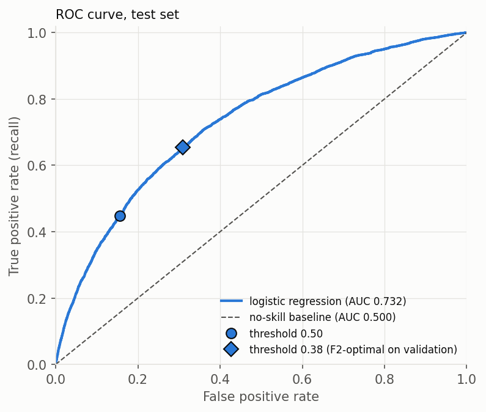
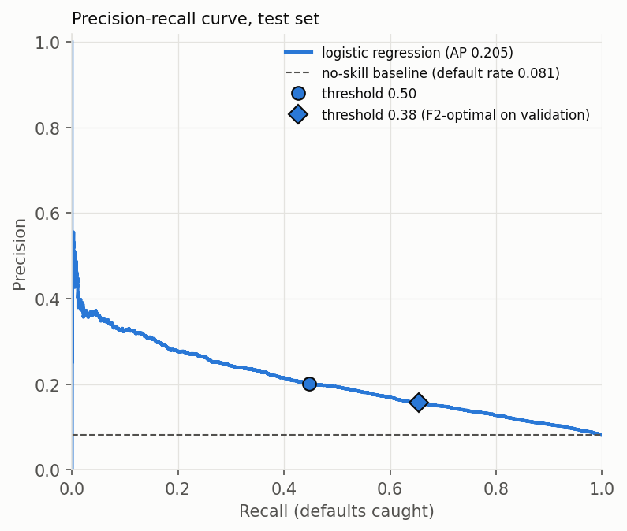
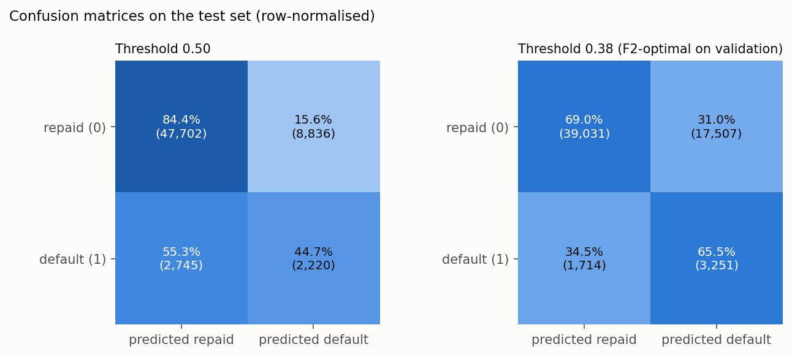
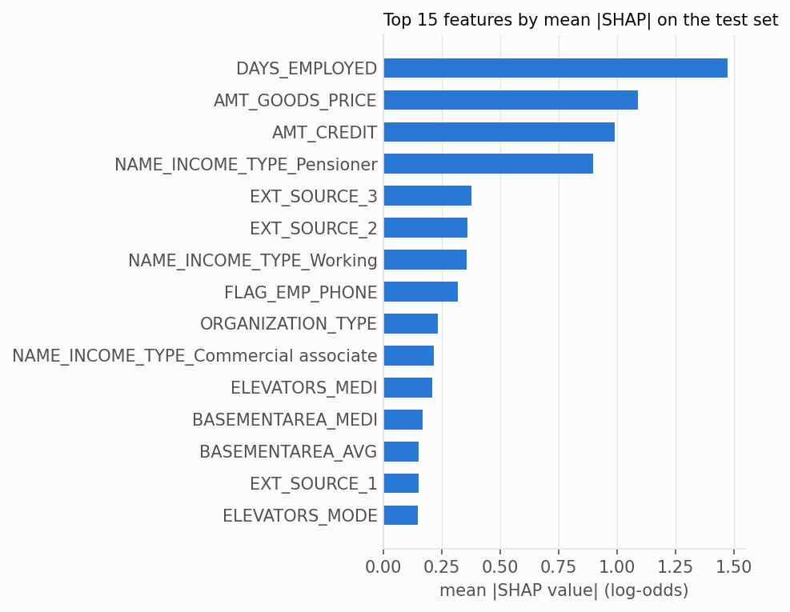

# Credit default risk: EDA and an interpretable classifier

[](https://github.com/josee2202/practica1_EDA/actions/workflows/ci.yml)


**Problem.** A lender wants to know, at application time, which applicants are likely to have payment difficulties. Only 8% of past applicants did, so a model that always says "will repay" is 92% accurate and useless.

**What this project does.** A notebook pipeline over 307,511 loan applications (122 columns): exploratory analysis, missing-value strategy, encoding and scaling, feature selection, class rebalancing, a comparison of seven classifiers, and a test-set evaluation of the chosen logistic regression with threshold tuning and SHAP explanations.

**Measured result** (held-out test set, 61,503 applications, never used for fitting or tuning):

| | ROC AUC | PR AUC | Recall (defaults caught) | Precision |
|---|---|---|---|---|
| Logistic regression, threshold 0.5 | 0.732 | 0.205 | 0.447 | 0.201 |
| Same model, F2-optimal threshold chosen on validation (0.38) | 0.732 | 0.205 | 0.655 | 0.157 |
| No-skill baseline (always predicts the base rate) | 0.500 | 0.081 | 0.000 | – |

The model ranks applicants clearly better than chance, but the signal is modest: to catch 65% of defaults it also flags 31% of the applicants who repaid, so about 1 in 6 flagged applicants actually defaults. This is a learning project, not a credit model ready for use (see [Limitations](#limitations)).

**Who it is for.** Reviewers who want to see a complete, honest tabular-ML workflow on imbalanced data, and anyone looking for a reproducible starting point on this public dataset. The notebooks are written in Spanish; this README, the figures and the code comments added during the recovery are in English.

**Try it.** `pytest tests` runs the whole pipeline on synthetic data in about 15 minutes, with no download needed. The full run on the real data is described in [Quick start](#quick-start).

---

## Results

<p align="center">
  
  
</p>
<p align="center">
  
</p>
<p align="center">
  
</p>

All numbers and figures are generated by `notebooks/05_Modelo_evaluacion.ipynb` into [`reports/`](reports/) (`metrics.json` has the full table, including accuracy, F1 and F2).

**How to read the numbers.**

- ROC AUC 0.732: a randomly chosen applicant who defaulted gets a higher score than a randomly chosen one who repaid 73% of the time. PR AUC 0.205 is about 2.5 times the 0.081 of a random ranking.
- The 0.38 threshold was chosen on the validation split by maximising F2. The threshold that would maximise F2 on the test set itself (0.35, F2 0.402 against 0.400) is stored in `metrics.json` only as an optimistic reference.
- The table above is the only result that comes from the test set. The model comparison below, copied from the outputs of notebook 04, is on the validation split, at threshold 0.5, after rebalancing the training data:

| Model (validation split) | Recall | Precision | F1 |
|---|---|---|---|
| Logistic regression (L1, C = 0.89) | 0.44 | 0.20 | **0.27** |
| LightGBM | 0.25 | 0.23 | 0.24 |
| Decision tree | 0.38 | 0.16 | 0.22 |
| XGBoost | 0.15 | 0.25 | 0.19 |
| Gaussian Naive Bayes | 0.74 | 0.10 | 0.18 |
| Dummy (most frequent class) | 0.00 | – | 0.00 |

  The boosting models were not compared on ROC or PR AUC, so this ranking depends on the 0.5 threshold.

- **SHAP.** `DAYS_EMPLOYED`, `AMT_GOODS_PRICE`, `AMT_CREDIT` and the pensioner flag dominate. These features are entangled, so read them in groups:
  - `DAYS_EMPLOYED` holds a placeholder value (365243) for 18% of applicants, almost all of them pensioners. Much of its weight therefore acts as a pensioner indicator rather than job tenure, and the `NAME_INCOME_TYPE_Pensioner` coefficient partly offsets it.
  - `AMT_CREDIT` and `AMT_GOODS_PRICE` have a correlation of 0.987 and get large coefficients of opposite sign.

## How it works

```mermaid
flowchart TD
    A[("application_data.csv<br/>307,511 x 122")] --> N1
    N1["01 Exploration<br/>target balance, missing values by column,<br/>variable types"] -->|"16 columns with more than 66% missing dropped;<br/>categorical lists in data/variables/"| N2
    N2["02 Treatment<br/>stratified 80/20 train/test split (seed 123)<br/>imputation fitted on train only:<br/>mean / median, KNN for credit-bureau counts,<br/>'sin_valor' category or mode for categoricals<br/>outliers, correlations, Cramér's V, WoE/IV"] -->|"train / test_data_processed.csv"| N3
    N3["03 Feature processing<br/>label, target and one-hot encoding<br/>StandardScaler fitted on train<br/>feature selection: L2 / L1 / ElasticNet logistic,<br/>RFE, Boruta (compared on a validation split)"] -->|"26 features chosen by L2-logistic<br/>df_train / df_test_scaled.csv"| N4
    N4["04 Models<br/>train / validation split of the training data<br/>SMOTE (0.4) + random undersampling (0.6) on the train part<br/>Dummy, Naive Bayes, logistic regression, decision tree,<br/>random forest, XGBoost, LightGBM<br/>randomized / grid search with cross-validation"] -->|"modelos/regresionlog.joblib<br/>modelos/umbral_f2.json (threshold from validation)"| N5
    N5["05 Evaluation on the test set<br/>confusion matrices, ROC, precision-recall,<br/>gain and lift curves, SHAP, partial dependence"] --> R[("reports/metrics.json<br/>reports/figures/")]
```



`src/funciones.py` holds the plotting and analysis helpers used by notebooks 01, 02 and 04.

## Quick start

Tested with Python 3.8 on macOS (Intel) and Ubuntu 24.04 (CI). Versions are pinned to the environment the notebooks were first run with.

```bash
git clone https://github.com/josee2202/practica1_EDA.git
cd practica1_EDA
conda create -n credit-risk-py38 python=3.8 -y && conda activate credit-risk-py38   # or any Python 3.8 venv
pip install -r requirements.txt pytest==8.3.3
# macOS only: the XGBoost/LightGBM wheels need the OpenMP runtime
conda install -c conda-forge llvm-openmp -y      # or: brew install libomp
```

**1. Synthetic smoke run (no data download, about 15 minutes):**

```bash
pytest tests -v
```

It writes a 6,000-row synthetic dataset with the real schema into a temporary workspace, runs notebooks 01-05 there and checks the artifacts. The synthetic target follows a hand-written rule, so its metrics say nothing about real performance; the run proves the code works end to end. CI runs exactly this.

**2. Full run on the real data (about 3 hours on a 16-thread laptop):**

```bash
# put application_data.csv in data/raw_data/ (see data/README.md)
python scripts/run_pipeline.py          # executes 01 -> 05 in place and validates the outputs
python scripts/run_pipeline.py --html   # same, and refreshes the HTML exports in html/
```

Expected ending of the output (scikit-learn warnings printed in between are expected, see [Limitations](#limitations)):

```
[05] running 05_Modelo_evaluacion.ipynb ...
[05] done in 29s
Artifacts OK. Test metrics (threshold 0.5): {"accuracy": 0.8117, "balanced_accuracy": 0.6454, "precision": 0.2008, "recall": 0.4471, "f1": 0.2771, "f2": 0.359}, ROC AUC 0.732, PR AUC 0.205
```

Where the time goes: in notebook 03, RFE (about 63 min) and Boruta (about 36 min), and in notebook 04 the randomized search for the logistic regression (about 40 min). Each notebook writes its outputs to disk, so after a change you can rerun only the affected stages.

Single notebooks can be rerun with `--start` / `--stop` (for example `--start 04 --stop 05`), or opened in Jupyter from the `notebooks/` folder. The runner creates the output folders; when running the notebooks by hand on a fresh clone, create them first with `mkdir -p data/processed_data data/variables reports/figures`.

## Configuration

There are no environment variables, API keys or external services. Inputs and outputs are fixed relative paths:

| Path | Content | Versioned |
|---|---|---|
| `data/raw_data/application_data.csv` | input data ([download](data/README.md)) | no |
| `data/processed_data/`, `data/variables/` | intermediate files written by notebooks 01-04 | no |
| `modelos/regresionlog.joblib`, `modelos/umbral_f2.json` | trained model and decision threshold | yes |
| `reports/` | test metrics and figures | yes |
| `html/` | HTML exports of the executed notebooks | yes |

`scripts/run_pipeline.py --help` lists the runner options (`--synthetic`, `--rows`, `--workdir`, `--start`, `--stop`, `--html`, `--timeout`).

## Evaluation method

- **Data split.** Stratified 80/20 train/test split with a fixed seed (notebook 02). All imputation, encoding, scaling and feature-selection steps are fitted on the training part only. Notebook 04 splits the training data again (80/20) into train and validation; resampling is applied only to that train part.
- **Test set use.** The test set is used once, in notebook 05. The decision threshold reported above was chosen on the validation split. Notebook 05 also shows the threshold that would be optimal on the test set itself; it is kept as a reference and labelled as optimistic.
- **Metrics.** Recall on the default class is the business priority (a missed default costs more than a rejected good payer), so the project reports recall, F2 (recall weighted twice as much as precision), precision-recall AUC and ROC AUC rather than accuracy.
- **Baseline.** A classifier that always outputs the training default rate. It has ROC AUC 0.5, PR AUC equal to the default rate and zero recall at any threshold above the base rate.

## Key decisions

| Decision | Chosen | Alternatives | Why |
|---|---|---|---|
| Columns with many missing values | drop columns with more than 66% missing (16 columns) | a lower cut; imputing everything | set in notebook 01 by comparing each column's missing share with the default rate among its missing rows; 66% keeps `OWN_CAR_AGE` (66.0% missing), judged potentially relevant |
| Imputation | mean, or median when mean and median differ by more than 25%; KNN (fitted on a 10% sample of train) for the `AMT_REQ_CREDIT_BUREAU_*` counts; a `sin_valor` category for categoricals | one global strategy; model-based imputation | the median resists the skew of income and amount variables; KNN on the full training set was too slow; a missing category may carry meaning of its own |
| Imbalance | SMOTE to a 0.4 minority/majority ratio, then random undersampling to 0.6, on the training part only | class weights; only one of the two samplers (not compared side by side) | on the raw data the vanilla logistic regression caught 0.9% of validation defaults (random forest 1.2%, XGBoost 2.5%); after rebalancing, the logistic regression caught 44%. The mix keeps the training size close to the original (196,806 rows before, 192,928 after) |
| Feature selection | L2-penalised logistic regression, keep features with absolute coefficient above 0.1 (26 of 148) | L1 (9 features), ElasticNet (25), RFE with a decision tree (20), Boruta (57), all run in notebook 03 | on a validation split of train, the L2 set gave the best F2 (0.36, with Naive Bayes) and, with the logistic regression, a PR AUC of 0.220 against 0.227 for Boruta's 57 features; RFE and Boruta took about 100 of the 106 minutes of notebook 03 |
| Final model | logistic regression (L1, `saga`, C = 0.89) | Naive Bayes, decision tree, XGBoost, LightGBM (all tuned); random forest (vanilla only) | best F1 on validation at threshold 0.5 (table above), and coefficients and SHAP values that are easy to explain, which matters in credit decisions |

## Limitations

This is a learning project. Known weaknesses:

- **One train/test split, no confidence intervals.** With about 5,000 defaults in the test set the estimates are fairly stable, but no repeated or cross-validated test estimate is reported.
- **Target encoding is fitted in-sample.** `ORGANIZATION_TYPE` and `OCCUPATION_TYPE` are target-encoded on the full training split without cross-fitting, so those two columns look slightly more predictive during feature selection and training than they are. The test set is encoded with the training mapping, so the test numbers are not affected by this leak, only the choices made on training data.
- **Some EDA decisions looked at the whole dataset.** The missing-value threshold and the categorical lists in notebook 01 were derived before the train/test split. They use missing rates and category lists, not the target on the test rows, so the effect should be small.
- **Cross-validation scores in notebook 04 are optimistic.** Resampling is done before the hyperparameter search, so synthetic SMOTE rows can land in the validation folds. Model choice relies on the separate validation split, and the final numbers on the untouched test set.
- **Scores are not calibrated probabilities.** The model is trained on rebalanced data, so a score of 0.5 does not mean a 50% chance of default.
- **The final logistic regression did not fully converge.** The `saga` solver stops at `max_iter=1000` (hence the `ConvergenceWarning`s during notebook 04). The original settings were kept so the recovery would not change the method. Raising `max_iter`, or using `liblinear` for the L1 penalty, is the obvious next step.
- **`DAYS_EMPLOYED` placeholder.** 18% of applicants (almost all pensioners) have the value 365243, which is kept as a number. The model uses it as a pensioner indicator, so its coefficient and SHAP value should not be read as an effect of job tenure.
- **Hand-written choices tied to the original run.** In notebook 04, the list of correlated columns to drop for one Naive Bayes experiment was written for the original feature selection; the current selection lacks one of those columns (`BASEMENTAREA_MODE`), which is now skipped with a printed note.
- **No inference pipeline.** The transformations are spread across notebooks 02-03; scoring a new raw application would require reapplying them in the same order. `modelos/regresionlog.joblib` expects the scaled, selected features.
- **No fairness analysis**, although the data includes gender, age and family status.
- **Old stack.** Everything is pinned to the Python 3.8 environment the notebooks were written in; Python 3.8 no longer receives security fixes.
- **CI uses synthetic data.** It proves the code runs end to end, not that the model is good; the real-data run was done locally.
- The Spanish commentary inside the notebooks quotes the numbers of the original December 2024 run (see [Project history](#project-history)).

## Repository structure

```
├── notebooks/            01-05 pipeline (Spanish); 04.1 and pipeline_version are unfinished experiments
├── src/funciones.py      helper functions used by the notebooks
├── scripts/
│   ├── run_pipeline.py        runs 01 -> 05 in fresh kernels and validates the outputs
│   └── make_synthetic_data.py synthetic dataset with the real schema (for tests and CI)
├── tests/test_pipeline.py     static check + synthetic end-to-end run
├── .github/workflows/ci.yml   runs the tests on every push to main and every pull request
├── docs/interview-notes.md    talking points: pitch, decisions, difficulties, likely questions
├── modelos/              trained model and decision threshold
├── reports/              metrics.json and figures produced by notebook 05
├── html/                 HTML exports of the executed notebooks
├── data/README.md        where to get the data and how the folder is laid out
├── env/                  original conda export (Dec 2024), kept for reference
└── requirements.txt      pinned, pip-installable dependencies
```

## Project history

The analysis and modelling were done between November 2024 and January 2025 as a university machine-learning assignment. In October 2026 the project was recovered and made reproducible; that work did not change the methodology beyond the fixes listed below:

- broken data paths and an absolute path from another machine; a helper module that was shadowed by a file handle; missing `scipy` imports in `src/funciones.py`;
- a cell in notebook 03 that overwrote an already-encoded column with raw text, and an exported category-to-encoding mapping that was misaligned;
- a fixed seed for the train/test split, removal of the `SK_ID_CURR` identifier from the model inputs, feature-selector comparison moved from the test set to a validation split, and the decision threshold now chosen on validation instead of test;
- seeds for the stochastic selectors used only in the selector comparison, and a hand-written column list in notebook 04 that assumed the original feature selection (the fixed seed changed the selected set slightly: 23 of the 26 features are the same as in the original run);
- pinned `requirements.txt`, the runner script, the synthetic dataset, the test and CI, and the `reports/` output.

The text inside the notebooks still quotes the numbers of the original December 2024 run; the cell outputs, `reports/` and this README come from the current run.

## License

No license has been chosen yet, so the default copyright rules apply: the code can be read, but not reused, until the author adds one. The dataset is not included. Its Kaggle page lists it as CC0, but the records derive from the Home Credit Default Risk competition data, so check both sets of terms before reusing it.
